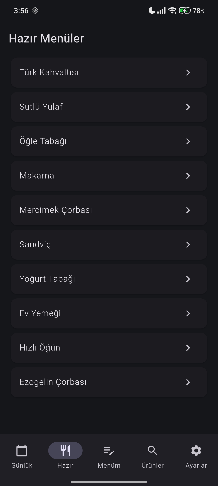
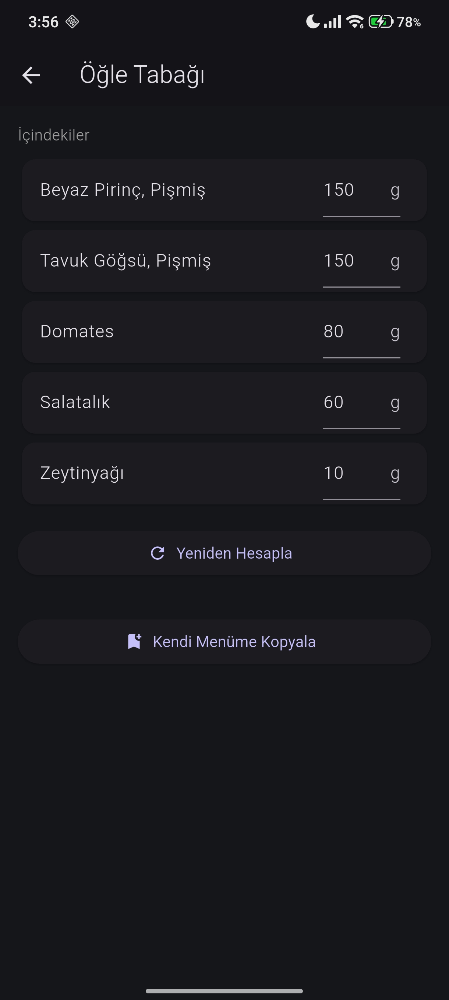
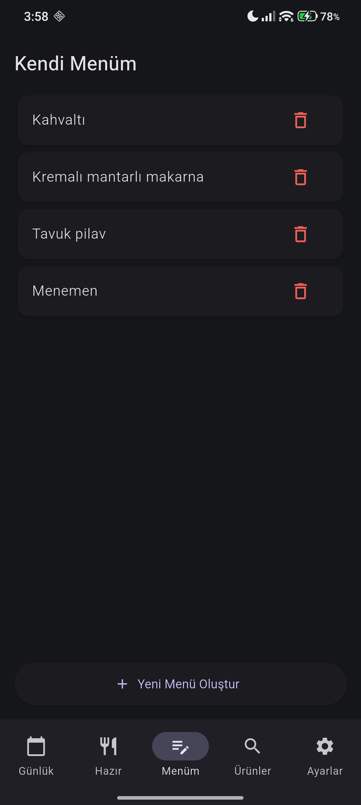
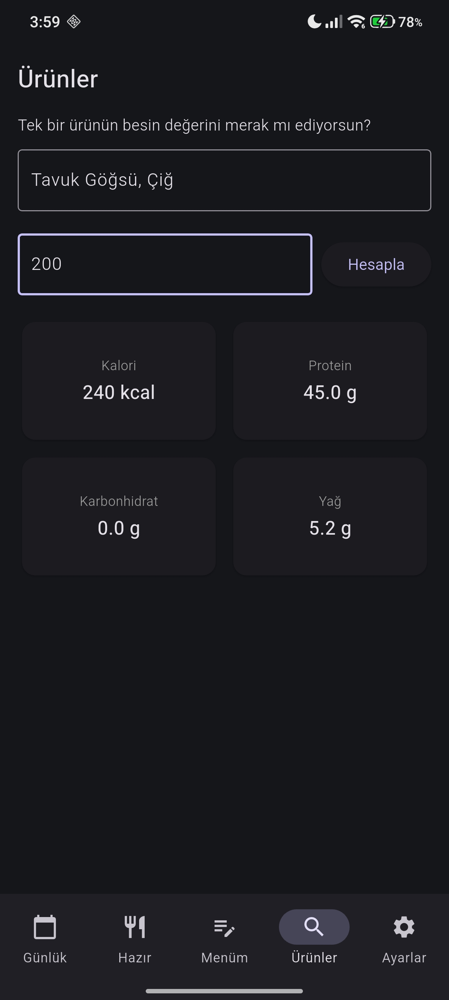
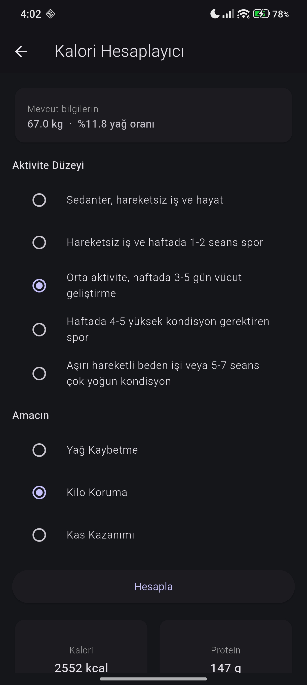
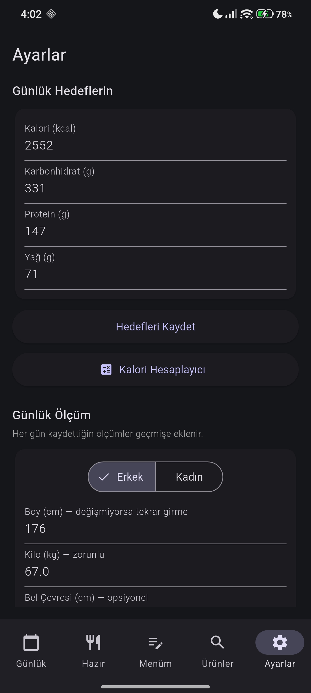
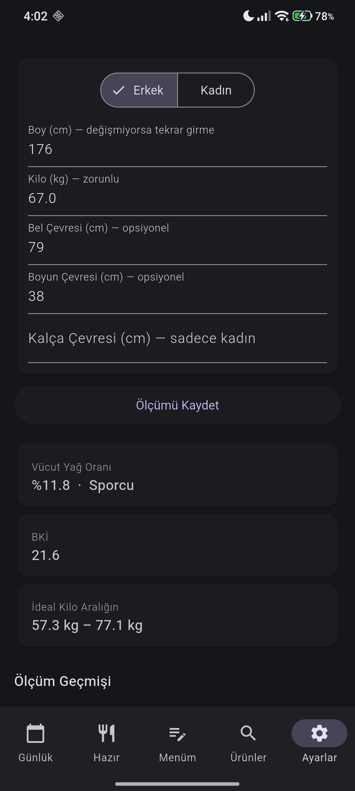

# 🍽️ Beslenme Sayacı

Günlük kalori ve makro besin takibi yapan Android uygulaması.

## Özellikler

- 📅 Günlük kalori ve makro besin takibi
- 🎯 Kişisel kalori/makro hedef belirleme
- 📊 Makro dağılımı grafiği ve performans haritası
- 🔥 Günlük seri (streak) takibi
- 🍳 Hazır menüler ve kişisel menü oluşturma
- ⚖️ Vücut yağ oranı hesaplama (US Navy Method)
- 🧮 Aktivite bazlı kalori hesaplayıcı
- 📈 Günlük ölçüm geçmişi

## Teknolojiler

- **Flutter / Dart**
- **SQLite** (drift ORM)
- **Python** (veri hazırlama ve USDA veri seti entegrasyonu)

## Ekran Görüntüleri

  
  
  
  
  
  
  

